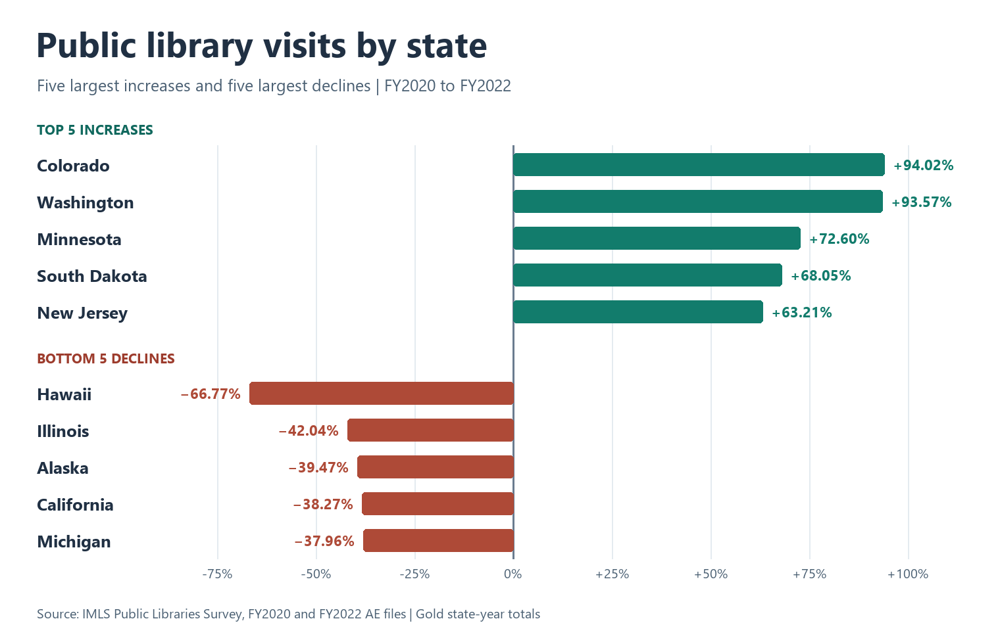

# Public library visits recovery, FY2020 to FY2022

Colorado and Washington had the largest percentage gains in visits between the two fiscal years, at **94.02%** and **93.57%**. Hawaii had the largest percentage decline, at **66.77%**. Among the five states with the largest percentage declines, California recorded the largest drop in visit counts, down **36,672,106**.

## State rankings

| Group | Rank | State | FY2020 visits | FY2022 visits | Change |
|---|---:|---|---:|---:|---:|
| Top 5 | 1 | Colorado (CO) | 9,320,267 | 18,083,346 | +94.02% |
| Top 5 | 2 | Washington (WA) | 9,749,970 | 18,872,705 | +93.57% |
| Top 5 | 3 | Minnesota (MN) | 7,863,564 | 13,572,215 | +72.60% |
| Top 5 | 4 | South Dakota (SD) | 1,480,357 | 2,487,777 | +68.05% |
| Top 5 | 5 | New Jersey (NJ) | 13,375,081 | 21,829,412 | +63.21% |
| Bottom 5 | 1 | Hawaii (HI) | 2,597,672 | 863,174 | -66.77% |
| Bottom 5 | 2 | Illinois (IL) | 50,159,232 | 29,074,138 | -42.04% |
| Bottom 5 | 3 | Alaska (AK) | 2,480,271 | 1,501,327 | -39.47% |
| Bottom 5 | 4 | California (CA) | 95,821,437 | 59,149,331 | -38.27% |
| Bottom 5 | 5 | Michigan (MI) | 33,880,114 | 21,019,746 | -37.96% |

## Method

The ranking uses total visits for the 50 U.S. states from the IMLS Public Libraries Survey Administrative Entity files, as aggregated in the project's Gold table. D.C. and the territories are outside the ranking scope. A state needs visit totals in both years and a positive FY2020 baseline to qualify.

For each eligible state, the change is 100 × (FY2022 visits − FY2020 visits) ÷ FY2020 visits. The script ranks the unrounded percentages, then displays two decimal places. The bottom five are ordered from the steepest percentage decline.

The results describe changes between FY2020 and FY2022. FY2020 is the baseline for this comparison, so the rankings do not establish a return to pre-pandemic visit levels.

The rankings can be reproduced from the populated Gold table by running the following command in the project directory.

~~~powershell
docker compose -p pls-pipeline exec -T airflow spark-submit --master 'local[2]' /opt/airflow/jobs/show_visits_recovery.py
~~~
